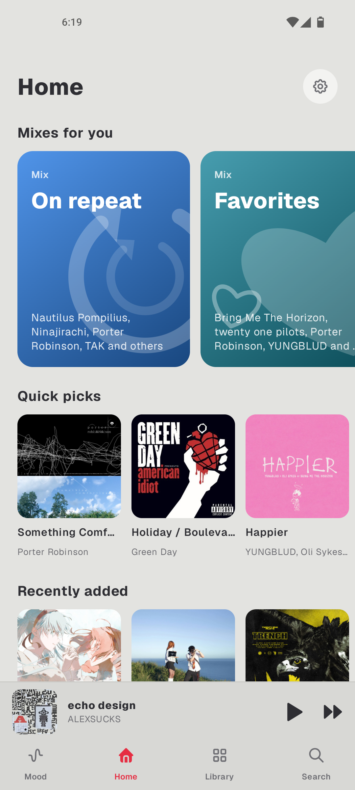
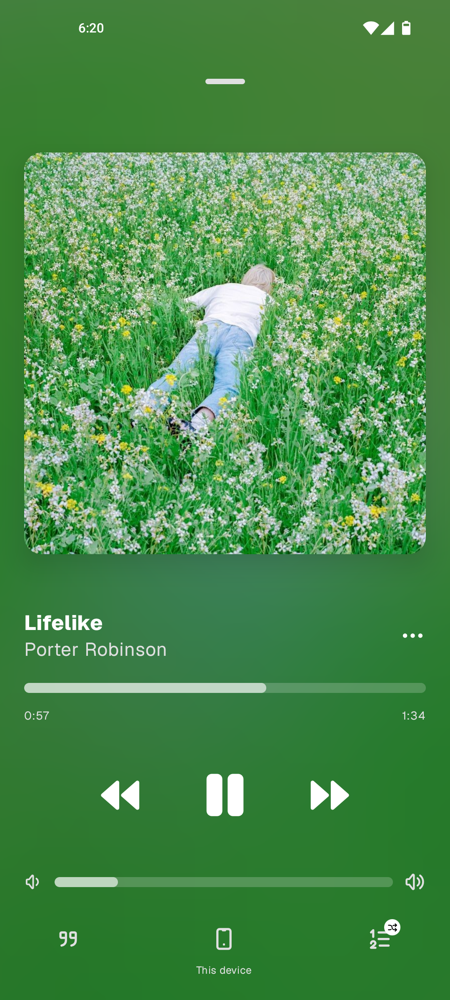
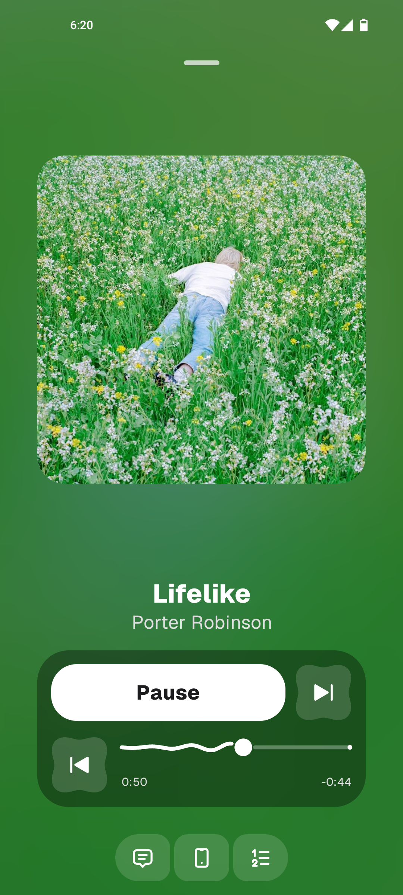
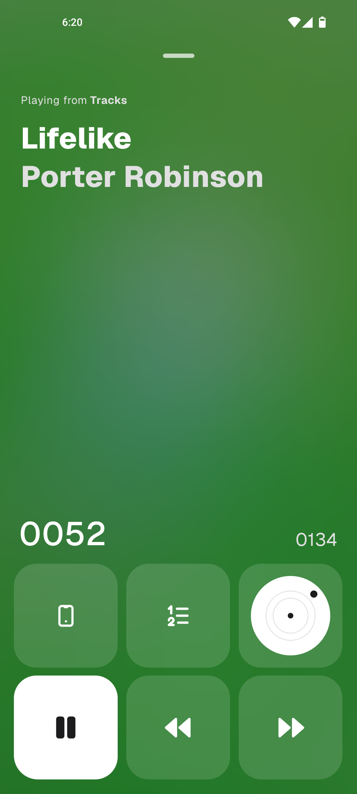
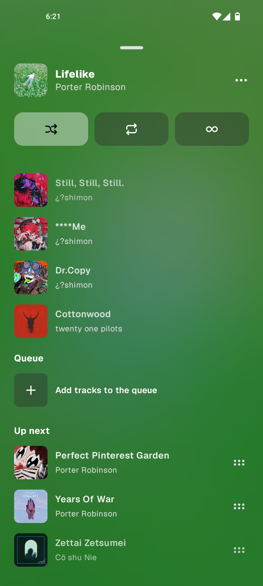
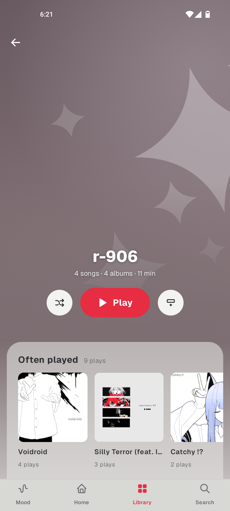
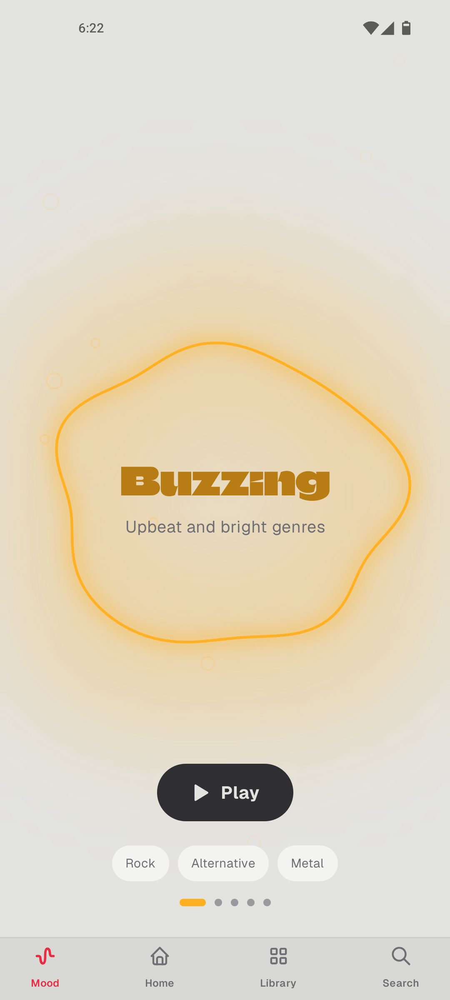
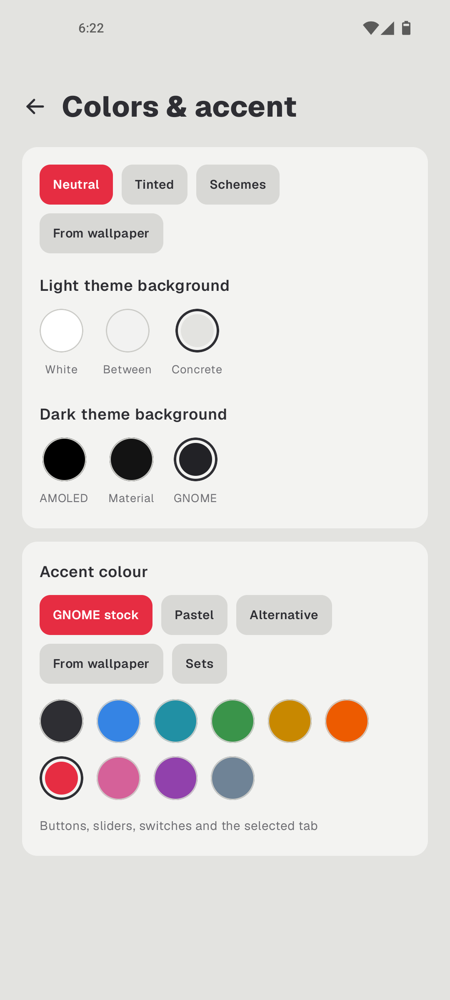
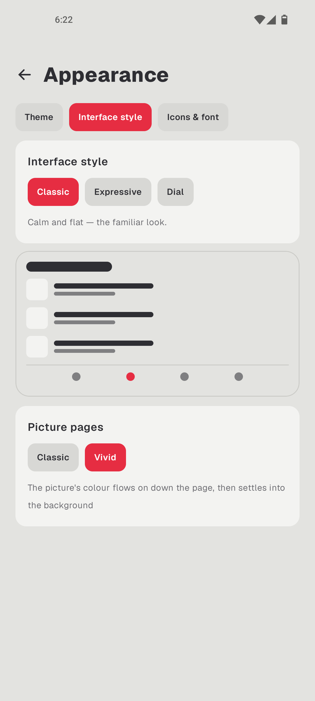
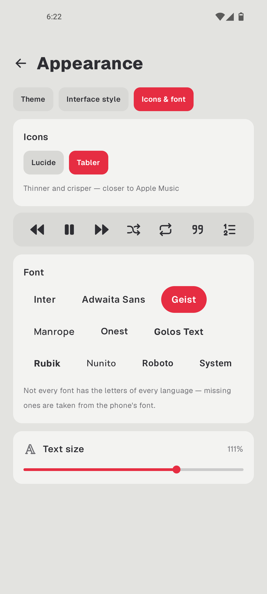

  <b>English</b> · <a href="README.ru.md">Русский</a>

## About

Lumine is an offline music player for Android that plays what's on your phone. It has no way to reach the internet, and it doesn't ask for much: only the permissions it needs to do its job.

I'm not a programmer. Everything you see here was thought up and tested by me, and written by an AI: I explained what I wanted, looked at what came out, said "not like that", and repeated that many times. The result is a player I use every day myself. So expect some rough or odd corners, and if you find one, tell me and we'll fix it.

     

     

## What it does

**Music**
- Plays the files on your phone: MP3, FLAC, Ogg, Opus, M4A, WAV, and ALAC, which Android doesn't like on its own.
- You can pick which folders the music comes from, so ringtones and voice notes stay out of the library.
- A queue with history: pull it down and you see what played before. You can drag and remove things there too.
- Soft transitions between songs. If an album plays straight through, it plays straight through, with no fades in the middle.
- Volume levelling from ReplayGain tags (optional, off by default). The app never writes anything to your files.

**Lyrics**
- Taken from the song's tags, or from `.lrc` and `.elrc` files next to it.
- Words light up as they're sung, when the lyrics have word-level timing.
- For Japanese, Korean and Chinese it can show the Latin spelling above the lines.
- It understands both the original language and the romanisation, and the "translation" lines inside the lyrics themselves.
- Hold a line and you get a card you can share.
- Search by lyrics: remember a line but not the song, and you can still find it.

**Library**
- Artists, albums, songs, years, genres, playlists. An artist's page shows what you play most.
- Mixes and weekly recaps that put themselves together from what you listen to. They need a few days to get to know you.
- A Mood tab: say how you feel and the player picks the music.
- Playlists can be exported and imported as M3U, and all your settings, playlists and stats can go into one file, so a reinstall doesn't lose them.

**Looks**
- Three styles for the whole app and three for the player screen: classic, expressive (with an "Island" variant) and "Disc", with a plate you can turn with a finger to wind the song.
- Light and dark themes, accent colours, dozens of fonts and several icon sets.
- A blurred background made from the cover, or a plain one, whichever you like.
- 13 languages: English, Russian, Ukrainian, Polish, Spanish, Portuguese, French, German, Italian, Turkish, Japanese, Chinese and Korean. Plus Russian as it was spelled before the 1918 reform, with yat and hard signs, because why not.

## Download

The latest APK is on the [Releases](../../releases) page. There are two files:

- `Lumine-<version>-Akashi.apk` — the normal build;
- `Lumine-<version>-Akashi-compressed.apk` — the same app, but shrunk, so it's lighter. Take it if you want the smaller size. If something's wrong with it, install the normal one and tell me.

Android 7.0 or newer is required. It works fine on Android 13 and newer, and no worse on Android 11.

## What's next

I'm out of ideas for now. But maybe I'll think of something. If you have one, write to [Issues](../../issues).

## Building

The source is open. You need JDK 21 and the Android SDK, and then it's the usual: `./gradlew assembleDebug` gives you an APK signed with a debug key.

My releases are signed with my own key, so what you build won't install over the one from me (and the other way round): you'll have to remove one of them first.

## Licences

Lumine is released under the [GNU GPL v3](LICENSE). The fonts, icons and libraries it uses are listed with their licences in [THIRD_PARTY.md](THIRD_PARTY.md).
